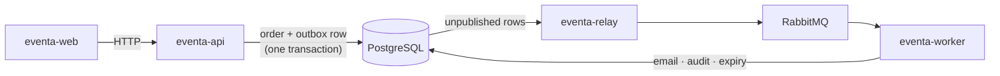

# Eventa

**Event registration & management for the Thai market.** Attendees discover events
and book tickets; organizers sell, check people in at the door, and get paid.

Multi-tenant, bilingual **EN/TH**, money in integer satang, **THB** with 7% VAT,
times **UTC on the wire and Asia/Bangkok on screen**. Card and **PromptPay**
payments through Stripe, under **PCI SAQ-A** — no card number ever reaches our
servers.

## Repositories

| Repository | What it is | Stack |
| --- | --- | --- |
| [**eventa-web**](https://github.com/kaungkhantdev/eventa-web) | Attendee portal, public event pages, organizer console | React 19 · Vite · Tailwind v4 |
| [**eventa-api**](https://github.com/kaungkhantdev/eventa-api) | All business rules. Owns the database schema and every migration | NestJS 11 · Drizzle · Postgres |
| [**eventa-relay**](https://github.com/kaungkhantdev/eventa-relay) | Publishes the transactional outbox to RabbitMQ | NestJS · amqplib |
| [**eventa-worker**](https://github.com/kaungkhantdev/eventa-worker) | Email, calendar sync, audit, scheduled domain jobs | NestJS · RabbitMQ · SMTP |
| [**eventa-docs**](https://github.com/kaungkhantdev/eventa-docs) | Requirements, architecture, data model, development guide | Markdown |
| [**eventa-ui-kit**](https://github.com/kaungkhantdev/eventa-ui-kit) | Static HTML/Tailwind kit — the visual source of truth | HTML · Tailwind (CDN) |
| [**eventa-infra**](https://github.com/kaungkhantdev/eventa-infra) | Terraform, Helm, Argo CD | Terraform · Helm |

## How the pieces fit



The API never talks to RabbitMQ, and the worker never talks to the API. They meet
through the database and the broker — so a domain change and the message
announcing it are written in **one transaction** and can never disagree.

📖 **[How the services connect](https://github.com/kaungkhantdev/eventa-docs/blob/main/04-architecture/how-services-connect.md)**
— the five-minute version, including what breaks when each service stops.

## Running it

Check the repos out side by side in one folder — `eventa`, `eventa-api`, `eventa-relay`,
`eventa-worker`, `eventa-web` — each service repo with its `.env`.

**One command**, from this folder:

```bash
docker compose up                                     # backing services + migrate + api + relay + worker
docker compose --profile seed run --build --rm seed   # once: the acme workspace and its admin
cd ../eventa-web && pnpm dev                          # the web stays on your machine → :5173
```

The first `up` builds three dev images, so it takes a few minutes; after that it starts in
seconds. Every `up` applies pending migrations before anything else starts. The api, relay
and worker each run `pnpm dev` against your checkout, mounted **read-only** — save a file and
that service reloads, as it does today, and nothing is ever written into your checkout.

> **Stop the api, relay and worker you run with `pnpm dev` first.** The containers take
> ports 3000 and 3100. The relay has no port to collide on, and a second one publishes
> every event twice — which can mean two confirmation emails for one order; a second
> worker quietly splits the queue with this one. Going back to running them by hand?
> `docker compose stop api relay worker` first.

| What | Where |
| --- | --- |
| API · Swagger | http://localhost:3000 · http://localhost:3000/api/docs |
| Worker health | http://localhost:3100/health/live — 3100 is the `PORT` in eventa-worker's `.env` |
| Mailpit — every email sent | http://localhost:8025 |
| RabbitMQ UI | http://localhost:15672 (eventa / eventa) |
| MinIO console | http://localhost:9001 (minioadmin / minioadmin) |

- **A dependency changed** (`package.json` or the lockfile, say after a pull)? `node_modules`
  lives in the image, built for Linux, so pnpm stops with `ERR_PNPM_VERIFY_DEPS_BEFORE_RUN`
  instead of running on the old one. If it's eventa-api's, `migrate` is what fails
  (`docker compose logs migrate`) and the api, relay and worker never start; if it's the
  relay's or the worker's, that service exits. Rebuild — `docker compose up -d --build`. The
  install reruns only where the lockfile changed; everything else comes from the build cache.
  The seed has an image of its own that `up` never builds, which is why its command carries
  `--build`.
- **Edited a root config file** (`tsconfig*.json`, `nest-cli.json`, `drizzle.config.ts`)?
  `docker compose restart api` — or `relay`, `worker`. Only `src/` reloads on its own.
- **Changed a `.env`?** `docker compose up -d`. Compose reads env files only when it creates a
  container, so `restart` keeps the old values; `up -d` sees the change and recreates the
  api, relay or worker that reads it — the worker reads eventa-api's `.env` too.
- **Logs:** `docker compose logs -f api`. **Stop:** `docker compose down` — your data stays
  in the `pgdata` and `miniodata` volumes.
- **The OpenAPI contract** is at http://localhost:3000/api/docs/json. With `EMIT_OPENAPI=true`
  the api writes `openapi.json` inside its container, not into `eventa-api`.

**Or by hand**, every service on your machine:

```bash
docker compose up -d          # in eventa-api: postgres, rabbitmq, mailpit
cd eventa-api    && pnpm migrate && pnpm seed && pnpm dev
cd eventa-relay  && pnpm dev   # ← without this, no email is ever sent
cd eventa-worker && pnpm dev
cd eventa-web    && pnpm dev
```

## Where to start reading

- **New here?** [How the services connect](https://github.com/kaungkhantdev/eventa-docs/blob/main/04-architecture/how-services-connect.md)
- **Building a feature?** [Development guide](https://github.com/kaungkhantdev/eventa-docs/blob/main/05-development/development-guide.md)
- **Changing the schema?** [Entity catalog](https://github.com/kaungkhantdev/eventa-docs/blob/main/04-architecture/entities.md) — and it starts in `eventa-api`
- **Why is it built this way?** [Software architecture + ADRs](https://github.com/kaungkhantdev/eventa-docs/blob/main/04-architecture/software-architecture.md)

## House rules

Every repo carries the same non-negotiables in its `AGENTS.md`:

- **PCI SAQ-A** — no card field, ever. Stripe owns the PAN.
- **Money is integer satang** on the wire, formatted once at the edge. `null` is not `0`.
- **The API is the source of truth.** Never dual-write.
- **TDD** — no production rule without a test that required it.
- **Authorization is server-side.** Hiding a button is tidying, not a control.
